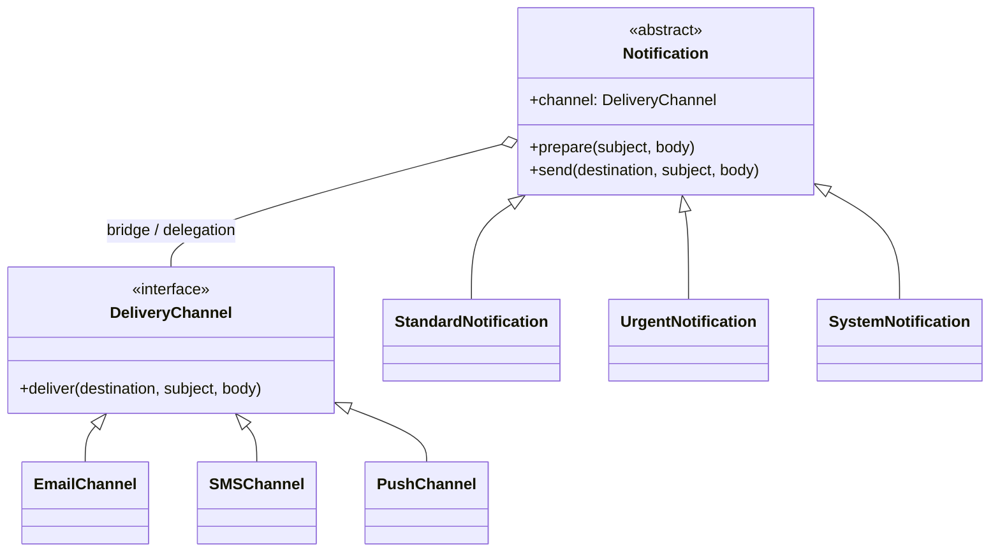

# Notification Studio — Bridge Pattern (Python)

A small desktop application demonstrating the **Bridge** structural design pattern.

## Run

Python 3.10+ recommended. Tkinter is bundled with many Python installations.

- **Arch Linux:** `sudo pacman -S python tk`
- **Debian/Ubuntu:** `sudo apt install python3 python3-tk`
- **Windows/macOS:** Python from python.org generally includes Tkinter.

In the extracted folder:

```bash
python main.py
```

No pip packages, Qt, databases, servers or accounts required.

## Pattern roles

| Bridge role | Class(es) |
|---|---|
| Abstraction | `Notification` |
| Refined Abstractions | `StandardNotification`, `UrgentNotification`, `SystemNotification` |
| Implementor | `DeliveryChannel` |
| Concrete Implementors | `EmailChannel`, `SMSChannel`, `PushChannel` |
| Client | `Studio` (GUI) |

The **bridge** is the `Notification.channel` object reference. `Notification.send()` delegates actual message rendering/delivery to `self.channel.deliver(...)`. Adding another notification type does **not** require changing the channel classes. Adding another channel does **not** require changing the notification types.

## Suggested demonstration

1. Select **Urgent** + **Email** and send. Observe the urgent prefix and email format.
2. Change only the channel to **SMS** and send. The urgent type remains the same, while the format changes.
3. Select **System** + **Push** to show another combination.
4. Explain why this avoids creating separate `UrgentEmail`, `UrgentSMS`, `SystemEmail`, etc. classes.

All messages are **simulated**; the application does not contact external services.

## UML (Mermaid)



## Notes

- `bridge.py` is all pattern/business logic and can be tested without a graphical display.
- `main.py` contains Tkinter UI only.
- This is a class assignment demo, not a production notification service.
